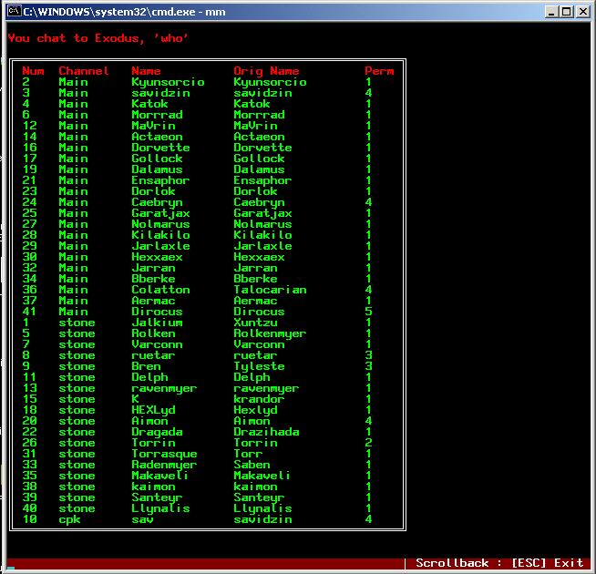

# MMChat by Dirocus

A chat server for MUD players, written in Visual Basic by a self-taught teenager starting around 1999 and maintained until 2015. It was dug out of an extremely old backup in 2026 and is published here as it was: every `dadata`, every `flase`, and every `DoEvents` busy-wait included.

## What it is

MUD clients of the era (MudMaster, zMUD, later MUSHclient) had a built-in peer-to-peer chat protocol: you `/chat` straight to another player's client. MMChat is a **hub** for that protocol. It looks like just another chat peer, so any client could connect to it, and on top of that it adds a server:

- **Accounts:** permission levels 0–5, password login, and per-account trusted IP pairs that skip the password.
- **Channels:** with password or level-restricted access, silent mode, and searchable logs (`log cpk 100`).
- **Messaging and moderation:** private messages with history, kick, ban (by name or IP), gag and auto-gag flood control, and a spam phrase filter.
- **Server management:** a MOTD, a welcome message with ANSI colour tokens, and a self-updater.
- **Plugins:** COM DLLs that add commands and can push timed broadcasts.

Players talked to the server by chatting commands to it, e.g. `/chat Server who`. It mostly served players of the MUD [Medievia](https://www.medievia.com).

> *"i was 100% self taught and created this application. it was not tied at all to mudmaster or zmud, but those were the only 2 i knew about at the time so i made it compatible with both."*
>
> Dirocus, [Gammon forum](https://www.gammon.com.au/forum/threads/15230.html), 2025

## Highlights

- **holofinder** (`Plugins/holofinder/`) is a GIF decoder written from CompuServe's GIF89a specification, LZW and all, with no image library. Every 10 minutes it downloaded Medievia's live world map, scanned four million pixels for "holo" markers, worked out fly directions and distance to the nearest road, and announced new ones to the chat. It took weeks of spare time and was slow as hell, but it worked.
- **Aim Notifier** logged into AOL Instant Messenger over the raw TOC2 protocol to IM-blast registered users.
- **telnet**: lets someone with nothing but `telnet` join the chat, by pretending to be a MudMaster client on their behalf.
- **DarkNomads**: riddle answers, catacomb combinations and clan-town lookups from darknomads.com, relayed into chat.
- **Battleship** over chat, and a Connect Four that never quite compiled (`As ibyte`).
- **A licence server** (`authserver/`) with challenge-response checks for registered installs.

Every plugin was written by Dirocus. The 2006 plugin SDK invited others to write their own, but nobody ever did.

## A bug that got famous (a little)

In 2010 a MUSHclient user couldn't log into an MMChat server. MudMaster worked, MUSHclient got "Incorrect...". Nick Gammon, MUSHclient's author, walked them through a Wireshark capture in [this thread](https://www.gammon.com.au/forum/threads/10198.html) (≈74k views). The cause was that MUSHclient wraps chat text in ANSI colour codes. Every other path into the server runs input through `stripansi()`, but password authentication (`pwauth` in `mmchat.frm`) doesn't. It's a one-line fix, still unapplied, preserved here for posterity.

## The history is in git

Every surviving version is a commit, backdated to its real file and build dates and tagged:

| Tag | Date | |
|---|---|---|
| `v3.4.2` | 2005-08 | Earliest surviving version. |
| `v3.5.1`, `v3.5.1-dec` | 2005-12 | CSocket networking, admin GUI. |
| `v3.6.8` | 2006-04 | INI settings, channel modes, first plugin loader. |
| `v4.0.3` | 2006-07 | Working plugin system. |
| `v4.1.2` | 2006-09 | Command table, spam filter. |
| `v4.3.2` | 2007-12 | Licensing removed, update check. |
| `v4.3.5`, `v4.3.6`, `v4.3.7-pre` | 2013 | Compiled binaries only; their source was lost. |
| `holofinder-1.01` | 2014-08 | |
| `v4.3.7` | 2015-01 | Final version. |

The abandoned 2008 attempt to restructure the whole server lives on the `refactor-2008` branch. **[HISTORY.md](HISTORY.md)** tells the story version by version.

**What was removed on import:**
- player accounts, message-board posts and passwords
- IP addresses (public ones replaced with documentation addresses)
- personal details, including the original website's hostname (now `mmchat.example.org`) and company name (now `Dirocus`)

Build intermediates and Microsoft redistributables were also left out. The compiled binaries are the original builds, with those strings overwritten in place at the same length.

## Repository layout

| Path | What |
|---|---|
| `mmchat.vbp`, `*.frm`, `*.bas`, `*.cls`, `Socket.ctl` | The server. Nearly all of it lives in `mmchat.frm`. |
| `mmchat.exe` | The original 4.3.7 build. |
| `Plugins/<name>/` | Plugin sources: Aim Notifier, Battleship, connect4, DarkNomads, fbfly, holofinder (plus its standalone predecessor in `gif/`), message board, Points, telnet, and the SDK `template`. |
| `Plugins/*.dll` | Compiled plugins. |
| `authserver/` | The licence server. The last version is an unfinished rewrite with an empty `.vbp`; check out `v4.1.2` for a buildable one. |
| `Help/` | Help text for each command (`help <command>`). |
| `MMChat.ini`, `users/`, `banned.txt`, `replist.txt` | Runtime configuration and data. `users/sysop.usr` is a sample account. |
| `archive-web/` | The original download site, recovered from the Wayback Machine. |

## Building and running

You need Windows and the **Visual Basic 6 IDE**.

1. Open `mmchat.vbp` and use File › Make `mmchat.exe`. The server uses no ActiveX controls and builds as-is.
2. Plugins: build `Plugins/<name>/*.vbp`. Most need `MSWINSCK.OCX` (Microsoft Winsock Control 6.0) registered.
3. Run `mmchat.exe`. It listens on the `Port` in `MMChat.ini` (default 4050). Add `service` on the command line to run without the UI. Plugins in `Plugins\` are registered and loaded automatically.
4. From a MUD client, `/chat` to the server's IP and port, then chat `help` to it. Log in as `sysop` with password `changeme` (edit `users/sysop.usr`).

The self-updater and update check point at the original website, which is long gone. Its hostname has been replaced with `mmchat.example.org` throughout, in the binaries too, so those features simply fail.

## Writing a plugin

Start from `Plugins/template/Class1.cls`, the original 2006 template. In short, an ActiveX DLL exposes a class named `Plugin` with:

- `GetName()`
- `GetCommands()`, returning `",cmd,level,cmd,level,"`
- `main(commandLine, othervars)`, returning results prefixed `0`–`6` to choose who receives them, separated by `~`
- optionally `Timer()`, polled every 100 ms

## License

Released into the public domain under [The Unlicense](LICENSE).

The exception is the CSocket class (`CSocket.cls`, `MSocketSupport.bas`). It is © 2002 Oleg Gdalevich and was published by him as free source code on vbip.com, with a copyright notice but no stated licence. It's included here, with its notice intact, because MMChat was built on it (in a modified form). It isn't covered by the public-domain dedication.

## Credits

- **MMChat and all plugins:** Dirocus.
- **Socket layer:** `CSocket.cls` and `MSocketSupport.bas` are © 2002 Oleg Gdalevich (vbip.com).
- **Battleship:** inspired by OMA's Battleship.
